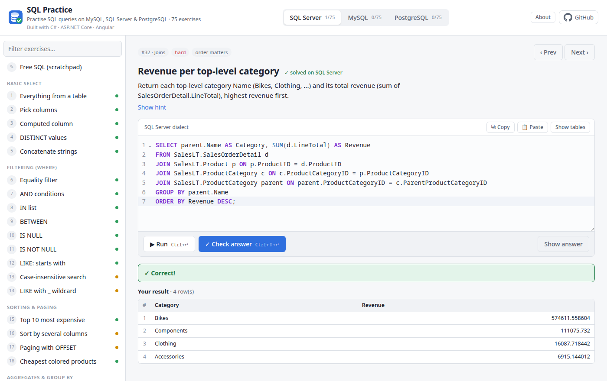
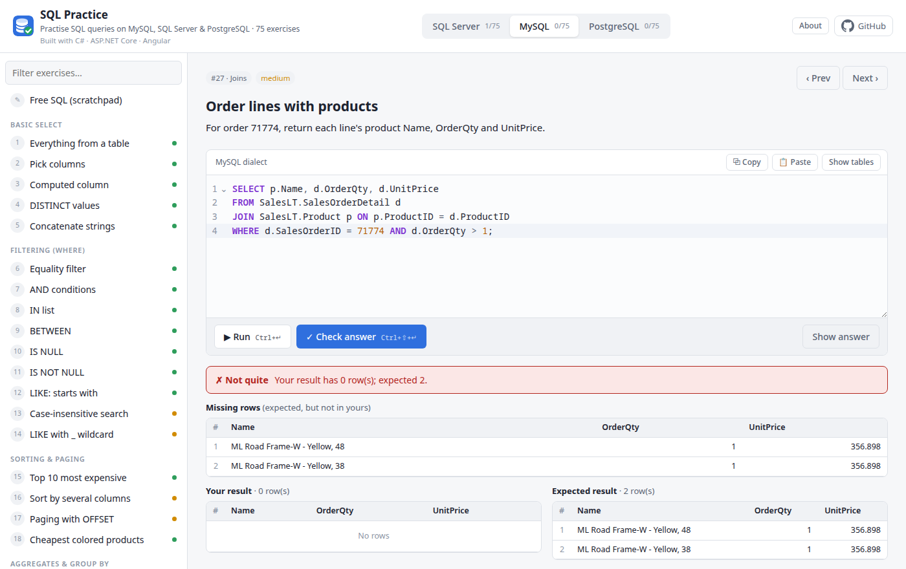
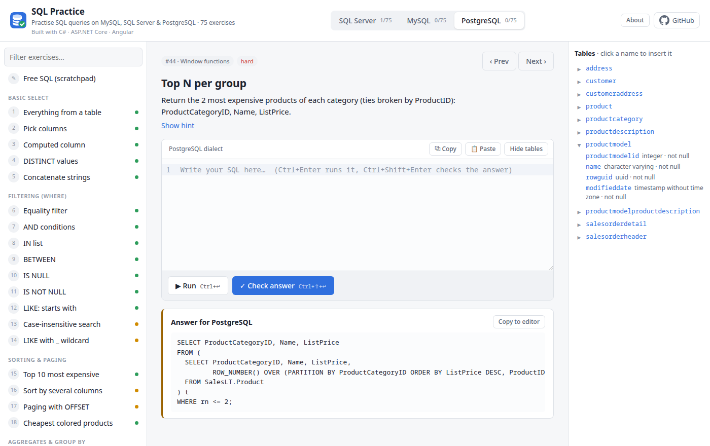

# SQL Practice: SQL Server · MySQL · PostgreSQL

[](https://github.com/alancj731/3dbs/actions/workflows/ci.yml)
[](LICENSE)


Practise SQL queries on three real databases, side by side, and get every answer graded instantly.

**▶ Try it: [mysql-sqlserver-postgres.vercel.app](https://mysql-sqlserver-postgres.vercel.app/)**. No sign-up; progress is saved in your browser.

Pick an exercise and a database, write your query, then **Run** it or **Check** your answer.
Stuck? **Show answer** reveals the correct SQL in that database's dialect.



| A wrong answer shows which rows are missing or unexpected | Answers per dialect, and a schema browser |
|---|---|
|  |  |

## Tech stack

| Layer    | Technology |
|----------|------------|
| Backend  | **C# / .NET 10**, **ASP.NET Core minimal API**, ADO.NET with Microsoft.Data.SqlClient, MySqlConnector and Npgsql, built-in rate limiting, `BackgroundService` |
| Frontend | **Angular 22** (standalone components, signals), TypeScript, CodeMirror 6 |
| Data     | SQL Server 2022, MySQL 8.4, PostgreSQL 17, loaded with Microsoft's AdventureWorksLT sample |
| Hosting  | Docker Compose on a Linux VM, Caddy (automatic HTTPS), Vercel (frontend and `/api` proxy) |
| Quality  | xUnit unit and endpoint tests, a cross-database verification script, GitHub Actions CI |

## Features

- **75 exercises in 13 categories**: SELECT, WHERE, sorting & paging, GROUP BY/HAVING, joins, subqueries,
  CTEs (including recursive), window functions, string/date functions & CASE, set operations, INSERT, UPDATE, DELETE.
- **Three databases, same data**: AdventureWorksLT loaded identically into SQL Server, MySQL and PostgreSQL.
  Switch databases and the same exercise is graded against that dialect.
- **Graded by result, not by text**: any query that returns the right rows passes. Column names don't matter,
  and row order only matters when the exercise asks for it.
- **Write exercises included**: INSERT/UPDATE/DELETE run in a transaction that is always rolled back.
  A check query runs after your statement and is graded, so it shows what you changed. The data never changes.
- **Schema browser and SQL editor**: CodeMirror with per-dialect highlighting and completion, plus every table and column one click away.

## Architecture

```
                         ┌───────────── Vercel ─────────────┐
 Browser ── HTTPS ──────►│ Angular app (static build)        │
    │                    └──────────────────────────────────┘
    │ HTTPS /api/* (CORS)
    ▼
 ┌──────────────────── Linux VM (Docker Compose) ──────────────────────────┐
 │  Caddy :80/:443  (Let's Encrypt; the only published ports)              │
 │     │ reverse_proxy /api/*                                              │
 │     ▼                                                                   │
 │  ASP.NET Core API :8080  (non-root container)                           │
 │     ├──► SQL Server 2022 Express   ┐                                    │
 │     ├──► MySQL 8.4                 ├ internal Docker network only       │
 │     └──► PostgreSQL 17             ┘                                    │
 └─────────────────────────────────────────────────────────────────────────┘
```

Vercel serves the Angular build; the browser then calls `/api/*` on the VM directly. The API allows that
cross-origin call only from the site's origin (`Cors:AllowedOrigins`), and Caddy sets `X-Real-IP` to the
visitor's real address, so the per-visitor rate limit can't be dodged by sending a fake header.
On the VM only Caddy publishes ports; the API and the databases are reachable only on the internal Docker network.

### What happens when you press Check

1. **Routing**: `POST /api/{db}/exercises/{id}/check` is mapped in `Endpoints.MapPracticeApi`. An unknown database or exercise returns 404.
2. **Rate limiting** (`Program.cs`): each visitor gets 60 SQL requests a minute (keyed on `X-Real-IP`, which Caddy sets),
   and the whole server runs at most 8 SQL requests at once, with up to 32 waiting.
3. **Validation**: `Runner.RunAsync` refuses empty SQL and SQL over 20,000 characters, then calls `SqlGuard.Validate`.
   This tokenizes the SQL the way the chosen database would and accepts only SELECT/WITH/INSERT/UPDATE/DELETE statements.
4. **Your query runs** as the restricted `practice` login, inside a transaction, with a 5 s timeout.
   For write exercises the exercise's check query runs afterwards in the same transaction. The transaction is always rolled back.
5. **The reference answer runs** the same way, on the same database.
6. **Comparison** (`Checker.Compare`): values are normalized (2-decimal rounding, bool → 1/0, trailing CHAR padding,
   int vs decimal), then rows are compared as an ordered list or as a multiset. Up to 20 missing and 20 unexpected rows are returned.
7. **Response**: a `CheckResult` JSON object (correct, message, both results, the row diff), which the Angular app renders.

### How your SQL is kept safe

1. **Statement allow-list**: only SELECT/WITH/INSERT/UPDATE/DELETE are accepted. The SQL is tokenized per dialect
   first, so comments, strings and quoting tricks can't hide a COMMIT, dynamic SQL or procedure call (`api/Practice/SqlGuard.cs`).
2. **Restricted login**: queries run as a `practice` user that can read and write rows but can't change the schema.
3. **Always rolled back**: every statement runs in a transaction that is rolled back afterwards.
4. **Limits**: 5 s per statement, 20,000 characters per query, 60 Run/Check requests per minute per visitor,
   8 queries at once across the server.

### Backend components (`api/`)

| Component | Responsibility | Design notes |
|-----------|----------------|--------------|
| `Program.cs` | DI registrations, rate limiter, startup seeding | Minimal hosting model; `Seed:OnStartup` and `Warmup:Enabled` can be switched off for tests. |
| `Endpoints.cs` | The 5 HTTP endpoints | Minimal API route group; `{db}` is parsed into the `Db` enum once, in `WithDb`. |
| `Data/DbRegistry.cs` | Creates `DbConnection`s for each database and role (`Admin`, `Practice`) | Plain ADO.NET instead of an ORM: users' SQL has to run exactly as written. |
| `Data/Seeder.cs` | Copies AdventureWorksLT from SQL Server into MySQL and Postgres on first start | Tables in foreign-key order, batched multi-row INSERTs, one transaction per database, Postgres identity sequences reset afterwards. |
| `Data/Warmup.cs` | Runs every reference answer at startup and pings each pool every 2 minutes | Keeps connection pools, plan caches and buffer caches warm, so a Check after a quiet period isn't slow. |
| `Practice/Exercises.cs` | Loads `Exercises.json`; picks the answer for each dialect | A dialect key (`sqlserver`/`mysql`/`postgres`) overrides `default`. |
| `Practice/SqlGuard.cs` | Decides whether SQL may run | A hand-written tokenizer per dialect, then an allow-list. Handles nested comments, `$tag$` strings, `E'…'` escapes, MySQL `/*! */`. |
| `Practice/Runner.cs` | Executes SQL in a rolled-back transaction and converts values to JSON-friendly types | Returns the last result set of a batch; caps rows (500 for display, 5,000 for grading). |
| `Practice/Checker.cs` | Grades a submission against the reference answer | Ignores column names; normalizes values across drivers; multiset diff; logs Checks slower than 2 s. |

### Frontend components (`web/src/app/`)

| Component | Responsibility |
|-----------|----------------|
| `app.ts` / `app.html` | The page: exercise list, editor, results, About dialog. All state lives in Angular signals. |
| `api.service.ts` | Typed `HttpClient` wrapper around the API |
| `sql-editor.ts` | CodeMirror 6 editor, switched to the current dialect, with table and column completion, Ctrl+Enter to run and Ctrl+Shift+Enter to check |
| `result-grid.ts` | The results table |
| `progress.ts` | Solved and revealed exercises and SQL drafts, kept in `localStorage` |

### API

| Method | Path | Body | Returns |
|--------|------|------|---------|
| GET  | `/api/exercises` | | Exercise list (id, category, difficulty, title, prompt, hint, ordered, kind). Answers are not included. |
| GET  | `/api/{db}/schema` | | Tables and their columns (name, type, nullable) |
| POST | `/api/{db}/run` | `{ "sql": "…" }` | `RunOutcome`: result (columns, rows, rowsAffected, truncated, elapsedMs) or error |
| POST | `/api/{db}/exercises/{id}/check` | `{ "sql": "…" }` | `CheckResult`: correct, message, yours, expected, missing, extra, error |
| GET  | `/api/{db}/exercises/{id}/answer` | | `{ sql, check }` for that dialect |

`{db}` is `sqlserver`, `mysql` or `postgres`.

## Data: one sample, three databases

- `setup.sh` downloads Microsoft's `AdventureWorksLT2022.bak` and restores it into SQL Server.
- On its first start the API's `Seeder` creates the schema in MySQL and Postgres (`db/*/schema.sql`) and copies every row
  over from SQL Server, so all three hold identical data.
- **Same names everywhere**: MySQL's database is named `SalesLT`, and Postgres uses unquoted (lower-case) names,
  so `SELECT FirstName FROM SalesLT.Customer` works as written on all three. Unqualified names (`FROM Customer`) work too.
- **Differences you'll meet**: `TOP` vs `LIMIT`, case-sensitive `LIKE` on Postgres (`ILIKE`),
  `LEN`/`CHAR_LENGTH`/`LENGTH`, `DATEDIFF`, `STRING_AGG`/`GROUP_CONCAT`, `WITH RECURSIVE`,
  `UPDATE … FROM` vs `UPDATE … JOIN`, `SCOPE_IDENTITY()`/`LAST_INSERT_ID()`/`RETURNING`.

## Run it locally

Requirements: Docker, .NET 10 SDK, Node 22+.

```bash
./setup.sh                            # start the 3 databases, restore AdventureWorksLT into SQL Server
dotnet run --project api              # API on http://localhost:5080; the first start copies the data into MySQL and Postgres
cd web && npm install && npm start    # UI on http://localhost:4200
```

The databases listen on `127.0.0.1` only. These logins are **local-dev defaults**; the server takes its passwords from `deploy/.env`.

| Database    | Port | Admin login                                        | Practice login           |
|-------------|------|----------------------------------------------------|--------------------------|
| SQL Server  | 1433 | sa / AwPractice!2026                               | practice / Practice!2026 |
| MySQL 8.4   | 3306 | root / AwPractice!2026                             | practice / Practice!2026 |
| Postgres 17 | 5432 | postgres / AwPractice!2026 (db `adventureworks`)   | practice / Practice!2026 |

## Tests and CI

```bash
dotnet test                                                   # unit + endpoint tests, no databases needed
RateLimit__SqlPerMinute=100000 dotnet run --project api &     # then, with the databases running:
python3 tests/verify_exercises.py                             # every exercise on every database
```

- **`api.Tests/SqlGuardTests`**: the allow-list, plus each dialect's comment and quoting rules
  (MySQL `--` and `#`, nested block comments, `$tag$` and `E'…'` strings, `[…]` and `` `…` `` identifiers, executable comments).
- **`api.Tests/CheckerTests`**: grading rules: order, duplicates, diff limits and value normalization across drivers.
- **`api.Tests/ExerciseTests`**: every exercise is complete, ids are unique, and every answer and check query passes `SqlGuard` on its database.
- **`api.Tests/EndpointTests`**: the real API in memory (`WebApplicationFactory`): routes, 404s, refused SQL and per-visitor rate limiting.
- **`tests/verify_exercises.py`**: against the running API, checks that each reference answer passes and that a wrong query fails.
  It also checks that read answers return the same rows on all three databases and that row counts are unchanged afterwards (proof of rollback).

[GitHub Actions](.github/workflows/ci.yml) runs three jobs on every push and pull request:
**API** (build and `dotnet test`), **Web** (`npm ci` and production build) and **Integration**
(starts all three databases with `setup.sh`, then runs `verify_exercises.py`).

## Adding an exercise

Add an entry to `api/Practice/Exercises.json`. `answer.default` is used unless a `sqlserver`, `mysql` or `postgres` key
overrides it. Write exercises also need a `check` query that shows what the statement changed:

```json
{
  "id": 65,
  "category": "INSERT",
  "difficulty": "hard",
  "title": "Insert, then use the new id",
  "prompt": "Add an address … and link it to customer 29485 in CustomerAddress with AddressType 'Shipping'.",
  "hint": "SQL Server: SCOPE_IDENTITY(). MySQL: LAST_INSERT_ID(). Postgres: RETURNING.",
  "ordered": false,
  "answer": {
    "sqlserver": "INSERT INTO SalesLT.Address (…) VALUES (…); INSERT INTO SalesLT.CustomerAddress (…) VALUES (29485, SCOPE_IDENTITY(), 'Shipping');",
    "mysql":     "… LAST_INSERT_ID() …",
    "postgres":  "WITH new_address AS (INSERT … RETURNING AddressID) INSERT INTO SalesLT.CustomerAddress … SELECT 29485, AddressID, 'Shipping' FROM new_address;"
  },
  "check": {
    "default": "SELECT ca.AddressType, a.AddressLine1, a.City FROM SalesLT.CustomerAddress ca JOIN SalesLT.Address a ON a.AddressID = ca.AddressID WHERE ca.CustomerID = 29485;"
  }
}
```

Then run `dotnet test` and `python3 tests/verify_exercises.py`.
To reload MySQL/Postgres from scratch, drop the MySQL `SalesLT` database or the Postgres `saleslt` schema, then restart the API.

## Deploy

Backend and databases on a Linux VM with Docker and automatic HTTPS, frontend on Vercel:
see [deploy/README.md](deploy/README.md).

## Project layout

```
.github/workflows/ci.yml        CI: API tests, Angular build, cross-database integration run
3dbs.slnx                       solution: api + api.Tests
docker-compose.yml              the 3 databases for local dev
setup.sh                        download + restore AdventureWorksLT2022.bak, create the practice login
LICENSE                         MIT

api/                            ASP.NET Core minimal API (C#, .NET 10)
  Program.cs                    DI, rate limiting, seeding at startup
  Endpoints.cs                  the HTTP endpoints
  Dockerfile                    multi-stage build, runs as the non-root "app" user
  Data/DbRegistry.cs            connection factory per database and role (admin / practice)
  Data/Seeder.cs                copies the data from SQL Server into MySQL and Postgres
  Data/Warmup.cs                warms up connections and caches; keeps them warm
  Practice/Exercises.json       the exercises: prompt + answer per dialect (+ check query for writes)
  Practice/Exercises.cs         exercise model and catalog
  Practice/SqlGuard.cs          per-dialect tokenizer + statement allow-list
  Practice/Runner.cs            runs SQL in a rolled-back transaction
  Practice/Checker.cs           compares your result with the reference answer's

api.Tests/                      xUnit tests (no databases needed)
  SqlGuardTests.cs  CheckerTests.cs  ExerciseTests.cs  EndpointTests.cs

web/                            Angular app
  src/app/app.ts, app.html      page component (signals)
  src/app/api.service.ts        typed API client
  src/app/sql-editor.ts         CodeMirror 6 SQL editor
  src/app/result-grid.ts        results table
  src/app/progress.ts           progress and drafts in localStorage
  vercel.json                   build settings

db/mssql/practice-login.sql     restricted login for SQL Server
db/mysql|postgres/schema.sql    SalesLT DDL + practice login per dialect (run by the seeder)
deploy/                         production compose file, Caddyfile, deploy.sh, .env.example
tests/verify_exercises.py       checks every exercise on every database (needs the API running)
docs/screenshots/               images used in this README
```

## License

[MIT](LICENSE)
